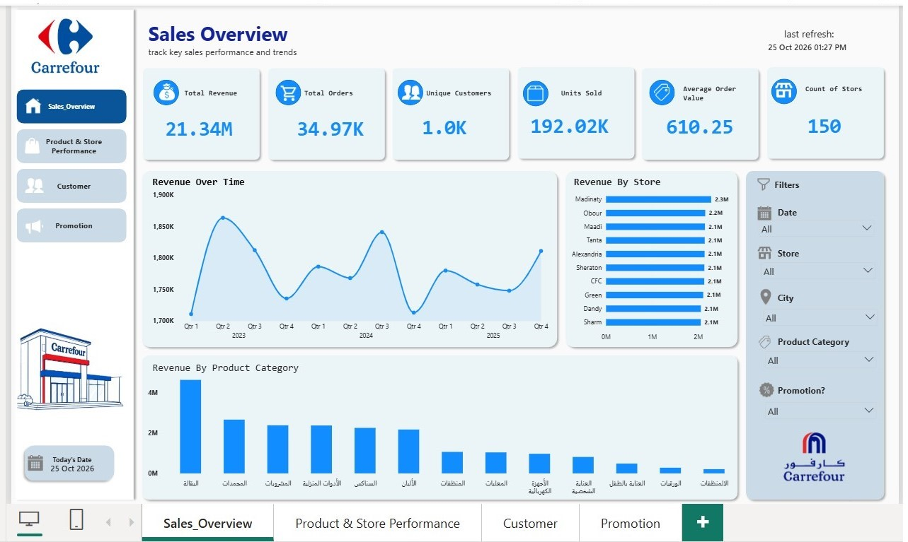
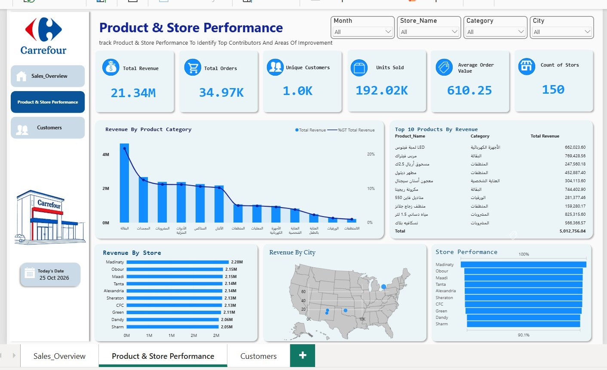
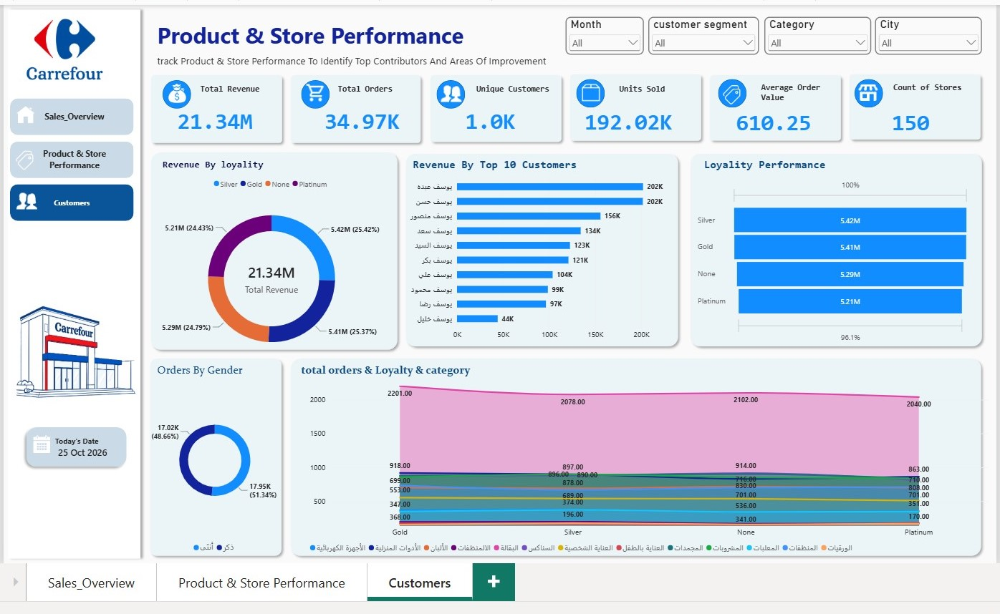

# Carrefour Retail Analytics Dashboard

An interactive Power BI report designed to explore retail sales, product and store performance, and customer-related metrics.

---

## Project Overview

This project presents a multi-page Power BI dashboard built around Carrefour retail analytics. It is intended to demonstrate how business data can be organized into an accessible reporting experience that supports performance monitoring and exploratory analysis.

## Report Pages

| Page | Focus |
| **Sales Overview** | High-level view of sales performance and key business indicators. |
| **Product & Store Performance** | Comparison of product and store performance to help identify patterns and areas for further investigation. |
| **Customers** | Customer-related analysis to support understanding of customer patterns. |

## Tools & Skills

- **Microsoft Power BI** — report design and interactive visual analytics
- **Data analysis** — exploring business performance across sales, products, stores, and customers
- **Business reporting** — structuring multiple report pages around business questions
-  **Business reporting** — Power Query, DAX

## Dashboard Preview

Sales Overview

### Product & Store Performance

### Customers

## Business Questions

- How does sales performance vary across the available time periods?
- Which products or stores stand out in the available performance measures?
- What customer patterns can be observed in the available data?
- Which areas deserve deeper analysis or operational follow-up?

## Analytical Scope

This project explores retail performance through three Power BI report pages: Sales Overview, Product & Store Performance, and Customers.
The report is designed to support analysis of sales performance, product and store comparisons, and customer patterns. Specific numerical findings will be documented only after validating the underlying data and measures.

Recommended format:
1. **Finding:** State a measurable pattern.
   - **Evidence:** Include the KPI, comparison, time period, and filter context.
   - **Business implication:** Explain why it matters.
2. **Finding:** State a second measurable pattern.
   - **Evidence:** Include the relevant measure and comparison.
   - **Business implication:** Explain a possible action or follow-up question.

## How to View the Report

1. Download `Dashboard/carrefour.pbix` from this repository.
2. Open it using Microsoft Power BI Desktop.
3. Use the report-page navigation to explore **Sales Overview**, **Product & Store Performance**, and **Customers**.
4. Interact with available slicers and visuals to inspect the data from different angles.

Built as a **Data Analyst portfolio project** using Microsoft Power BI.

